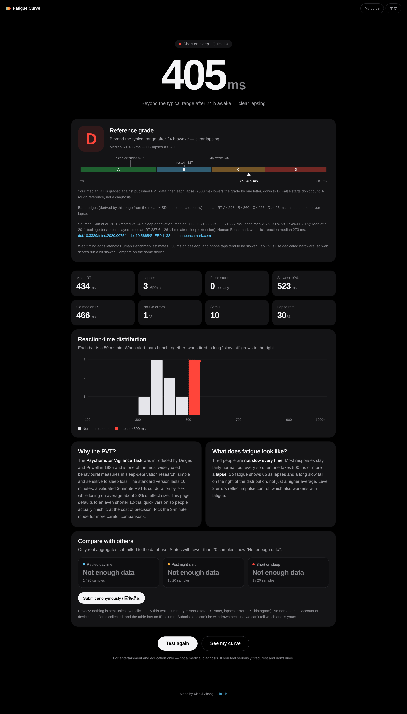

# Fatigue Curve · 疲劳曲线

> After a night shift, how much reaction is left? A 90-second vigilance test from sleep science.

**Live:** https://zhangxiaoxi2025.github.io/fatigue-curve/  (English by default; switch to 中文 with the toggle in the top-right)

A single-page, bilingual (English / 中文) vigilance test that uses the **Psychomotor Vigilance Task (PVT)**, the standard behavioural test in sleep-deprivation research, plus a Go/No-Go level. Tag each test as *rested daytime*, *post night shift* or *short on sleep*, and watch your own fatigue curve grow.

| Result | My curve | Mobile | 中文界面 |
|---|---|---|---|
|  |  |  |  |

Screenshots come from an automated simulated run, not real measurements.

## How it works

The whole test takes about 1.5 minutes by default.

1. **Pick your state:** 白天清醒 rested daytime · 下夜班 post night shift · 熬夜/睡眠不足 short on sleep.
2. **Level 1, PVT:** a running millisecond counter appears at a random moment. Respond with **Space** or a **tap**.
   - **Quick (default):** 10 trials with random 2–5 s waits, about 50 s.
   - **Standard:** 3 minutes with random 2–10 s waits.
   - *Lapse*: RT ≥ 500 ms (30 s timeout). *False start*: a press before the stimulus, or an RT under 100 ms.
3. **Level 2, Go/No-Go:** 20 trials (30 in standard mode), about 30 s. Green circle = press, red square = hold back (20% No-Go). The page records commission errors, omissions and Go RT.
4. **Result:**
   - An **A–D reference grade** based on published data (see below).
   - Median and mean RT, lapses and lapse rate, false starts, slowest 10% mean, No-Go errors.
   - An **RT histogram** that shows the slow tail.
5. **My curve:** history lives in `localStorage` and is shown as a curve over time plus a comparison of the three states. You can export, import or clear it as **CSV**.
6. **Optional, opt-in anonymous submission** to Supabase. The community comparison shows **only real aggregates** from the database. Any state with fewer than 20 samples shows “样本不足 / Not enough data”.

### Why 10 trials?

The quick mode is a usability trade-off. With 5 trials a single slow response would already be a 20% lapse rate, so lapses would be close to meaningless. Ten trials give 10% resolution and still finish in under a minute.

Shorter tests are less sensitive. The validated 3-minute PVT-B cut duration by 70% and lost about 23% of effect size on average (Basner, Mollicone & Dinges 2011). This quick mode is shorter still and has **not** been validated, so the 3-minute mode is there for more careful comparisons.

The lapse threshold stays at the standard 500 ms so lapse rates are comparable with the reference data below. PVT-B itself recommends 355 ms for its 3-minute format.

## Reference grade (A–D)

1. **Base grade from median RT.** The band edges are this page's own choice, derived from the mean ± SD reported by Sun et al. 2020: rested median RT 326.7 ± 33.3 ms; after 24 h awake, 369.7 ± 55.7 ms (7-min PVT).
2. **Each lapse (RT ≥ 500 ms) lowers the grade by one letter**, down to D. Example: an RT grade of B with one lapse gives C, and A with one lapse gives B. For context, the same study reports a lapse ratio of 2.5% ± 3.6% when rested versus 17.4% ± 15.0% after 24 h awake, so even one lapse in a short test is notable.
3. **False starts are shown but don't affect the grade.** On a web page they often come from accidental taps or key bounce rather than fatigue.

| Grade | Median RT | Meaning |
|---|---|---|
| A | ≤ 293 ms (rested mean − 1 SD) | Faster than well-rested adults in the source |
| B | ≤ 360 ms (rested mean + 1 SD) | Typical well-rested range |
| C | ≤ 425 ms (24 h-awake mean + 1 SD) | Slower than rested, near the 24 h-awake average |
| D | > 425 ms | Beyond the typical 24 h-awake range |

Other context shown on the page:
- Mah et al. 2011: college basketball players' PVT median RT went from 287.6 ± 65.9 ms at baseline to 261.4 ± 35.8 ms after weeks of sleep extension (weekly PVT, Table 3).
- Human Benchmark: across about 81 million web clicks, the median click reaction time is 273 ms (a simple click task, not a PVT). The site estimates about 30 ms of typical desktop display and input lag and notes that mobile taps tend to be slower.

**Caveats:** this is a rough reference, not a diagnosis. The norms come from lab or computer PVTs with different durations, hardware and populations. Browsers, screens and touchscreens add latency, so phone results usually run slower. Compare yourself on the same device.

## Privacy

Nothing leaves your device unless you click **匿名提交 / Submit anonymously**. A submission contains only the test summary (state, test length, RT stats, lapses, false starts, No-Go errors, n, RT histogram, app version). The table has no columns for names, emails, accounts, device IDs or IPs.

Database design ([`supabase/schema.sql`](supabase/schema.sql)):
- RLS is on, and the anonymous role only gets column-level `INSERT`. CHECK constraints validate value ranges and limit sizes.
- There is no `SELECT`, `UPDATE` or `DELETE` access to raw rows.
- Community stats come from the `SECURITY DEFINER` function `pvt_aggregate()`, which returns only per-state counts and percentiles, and only when a state has n ≥ 20.
- A simple global rate-limit trigger blocks floods.

## Science

- The PVT is a simple reaction-time task that is very sensitive to sleep loss and has minimal learning effects. Fatigue shows up less as a uniformly slower RT and more as **lapses** and a longer **slow tail**.
- Basner & Dinges 2011 found that lapse- and response-speed metrics are the most sensitive PVT outcomes. Mean and median RT were less sensitive, and the page shows both kinds of metric.

References (all checked against Crossref or Europe PMC):
1. Dinges DF, Powell JW. Microcomputer analyses of performance on a portable, simple visual RT task during sustained operations. *Behavior Research Methods, Instruments, & Computers*. 1985;17:652–655. doi:[10.3758/BF03200977](https://doi.org/10.3758/BF03200977)
2. Basner M, Dinges DF. Maximizing sensitivity of the Psychomotor Vigilance Test (PVT) to sleep loss. *Sleep*. 2011;34(5):581–591. doi:[10.1093/sleep/34.5.581](https://doi.org/10.1093/sleep/34.5.581)
3. Basner M, Mollicone D, Dinges DF. Validity and sensitivity of a brief psychomotor vigilance test (PVT-B) to total and partial sleep deprivation. *Acta Astronautica*. 2011;69:949–959. doi:[10.1016/j.actaastro.2011.07.015](https://doi.org/10.1016/j.actaastro.2011.07.015)
4. Sun J, Zhao R, Yang X, Deng H, Zhu Y, Chen Y, et al. Alteration of brain gray matter density after 24 h of sleep deprivation in healthy adults. *Frontiers in Neuroscience*. 2020;14:754. doi:[10.3389/fnins.2020.00754](https://doi.org/10.3389/fnins.2020.00754) (Table 1)
5. Mah CD, Mah KE, Kezirian EJ, Dement WC. The effects of sleep extension on the athletic performance of collegiate basketball players. *Sleep*. 2011;34(7):943–950. doi:[10.5665/SLEEP.1132](https://doi.org/10.5665/SLEEP.1132) (Table 3)
6. Human Benchmark. Reaction Time Statistics. https://humanbenchmark.com/tests/reactiontime/statistics (accessed 2026-11-22)

> **Disclaimer:** this is for entertainment and education only and is not a medical diagnosis. Browser timing varies across devices (display refresh, input latency), so compare results on the same device. If you feel seriously tired, rest, and don't drive.

## Self-hosting

1. Create a Supabase project and run `supabase/schema.sql` in its SQL editor.
2. In `index.html`, set `SUPABASE_URL` and `SUPABASE_KEY` (the anon/publishable key, which is designed to be public because RLS protects the data).
3. Serve the folder with any static host, such as GitHub Pages.

If you leave the config empty, the app works fully offline and hides the submit button.

## 中文简介

**下夜班后，你还剩几成反应？** 这是一个约一分半就能测完的网页版警觉测试，测法来自睡眠研究里最常用的精神运动警觉测试（PVT）。界面默认英文，右上角可以切换到中文。

- **第一关 PVT：** 默认 10 次，约 1 分钟。数字在随机时刻出现，看到就按空格或点屏幕。反应 ≥500 ms 记为一次「走神」。也可以选标准 3 分钟版。
- **第二关 Go/No-Go：** 20 次，约 30 秒。绿色圆就按，红色方块忍住。
- **结果：** 中位反应时、走神、抢跑、误按和反应时分布图。另外给出 A–D 参考等级：先按中位反应时对照已发表研究（Sun 等 2020：睡够 326.7±33.3 ms，通宵 24 小时 369.7±55.7 ms）定级，每次走神降一级，抢跑不计入。只是粗略参考，不是诊断；网页和手机触屏会让成绩偏慢一些。
- **疲劳曲线：** 每次测试按「白天清醒 / 下夜班 / 熬夜或睡眠不足」保存在本机，可以导出、导入 CSV。
- **匿名提交（可选）：** 只提交成绩摘要，不收集任何身份信息。某个状态不足 20 份样本时只显示「样本不足」，绝不显示编造的平均值。

仅供娱乐与科普，不是医学诊断。如果你感到严重疲劳，请休息，别开车。

## License

MIT © 2026 Xiaoxi Zhang
