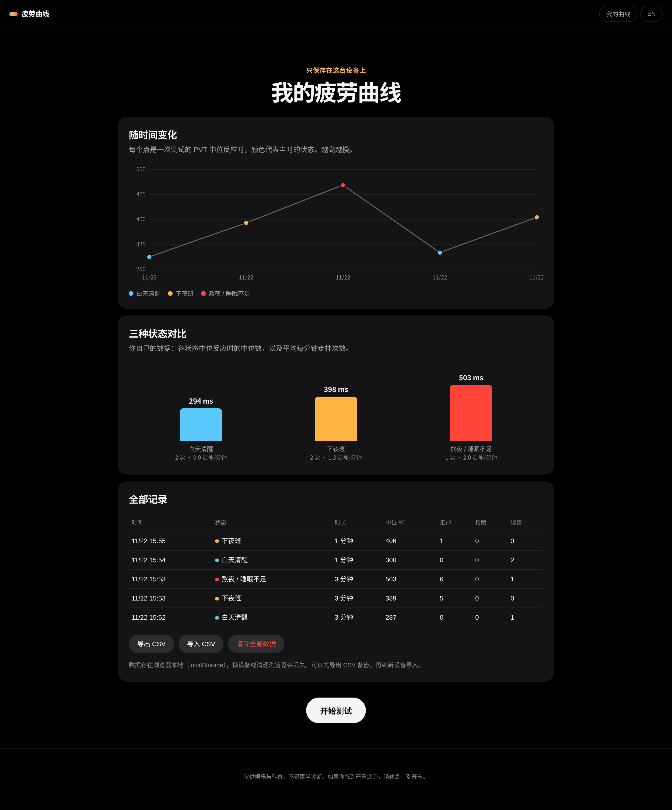

# 疲劳曲线 · Fatigue Curve

> 下夜班后，你还剩几成反应？ / How much reaction is left after a night shift?

**Live:** https://zhangxiaoxi2025.github.io/fatigue-curve/

A single-page, bilingual (中文 / English) vigilance test that uses the **Psychomotor Vigilance Task (PVT)**, the standard behavioural test in sleep-deprivation research, plus a Go/No-Go level. Tag each test as *rested daytime*, *post night shift* or *short on sleep*, and watch your own fatigue curve grow.

| Result | My curve | Mobile |
|---|---|---|
|  |  |  |

Screenshots come from an automated simulated run, not real measurements.

## How it works

1. **Pick your state:** 白天清醒 rested daytime · 下夜班 post night shift · 熬夜/睡眠不足 short on sleep.
2. **Level 1, PVT (3 min, or a quick 1 min):** a running millisecond counter appears after a random 2–10 s wait. Respond with **Space** or a **tap**.
   - *Lapse*: RT ≥ 500 ms (30 s timeout).
   - *False start*: a press before the stimulus, or an RT under 100 ms.
3. **Level 2, Go/No-Go:** green circle = press, red square = hold back (~20% No-Go). The page records commission errors (pressing on No-Go), omissions and Go RT.
4. **Result:** median and mean RT, lapses, false starts, slowest 10% mean, No-Go errors, and an **RT histogram** that shows the slow tail.
5. **My curve:** history lives in `localStorage` and is shown as a curve over time plus a comparison of the three states. You can export, import or clear it as **CSV**.
6. **Optional, opt-in anonymous submission** to Supabase. The community comparison shows **only real aggregates** from the database. Any state with fewer than 20 samples shows “样本不足 / Not enough data”.

No build step and no dependencies: everything is in one `index.html`.

## Privacy

Nothing leaves your device unless you click **匿名提交 / Submit anonymously**. A submission contains only the test summary (state, test length, RT stats, lapses, false starts, No-Go errors, n, RT histogram, app version). The table has no columns for names, emails, accounts, device IDs or IPs.

Database design ([`supabase/schema.sql`](supabase/schema.sql)):
- RLS is on, and the anonymous role only gets column-level `INSERT`. CHECK constraints validate value ranges and limit sizes.
- There is no `SELECT`, `UPDATE` or `DELETE` access to raw rows.
- Community stats come from the `SECURITY DEFINER` function `pvt_aggregate()`, which returns only per-state counts and percentiles, and only when a state has n ≥ 20.
- A simple global rate-limit trigger blocks floods.

## Science

- The PVT is a simple reaction-time task that is very sensitive to sleep loss and has minimal learning effects. Fatigue shows up less as a uniformly slower RT and more as **lapses** and a longer **slow tail**.
- This page uses shortened 3- and 1-minute versions. The standard PVT lasts 10 minutes, and a validated 3-minute PVT-B exists, but its parameters differ from this page.

References:
1. Dinges DF, Powell JW. Microcomputer analyses of performance on a portable, simple visual RT task during sustained operations. *Behavior Research Methods, Instruments, & Computers*. 1985;17:652–655. doi:[10.3758/BF03200977](https://doi.org/10.3758/BF03200977)
2. Basner M, Dinges DF. Maximizing sensitivity of the Psychomotor Vigilance Test (PVT) to sleep loss. *Sleep*. 2011;34(5):581–591. doi:[10.1093/sleep/34.5.581](https://doi.org/10.1093/sleep/34.5.581)
3. Basner M, Mollicone D, Dinges DF. Validity and sensitivity of a brief psychomotor vigilance test (PVT-B) to total and partial sleep deprivation. *Acta Astronautica*. 2011;69:949–959. doi:[10.1016/j.actaastro.2011.07.015](https://doi.org/10.1016/j.actaastro.2011.07.015)

> **Disclaimer:** this is for entertainment and education only and is not a medical diagnosis. Browser timing varies across devices (display refresh, input latency), so compare results on the same device. If you feel seriously tired, rest, and don't drive.

## Self-hosting

1. Create a Supabase project and run `supabase/schema.sql` in its SQL editor.
2. In `index.html`, set `SUPABASE_URL` and `SUPABASE_KEY` (the anon/publishable key, which is designed to be public because RLS protects the data).
3. Serve the folder with any static host, such as GitHub Pages.

If you leave the config empty, the app works fully offline and hides the submit button.

## License

MIT © 2026 Xiaoxi Zhang
